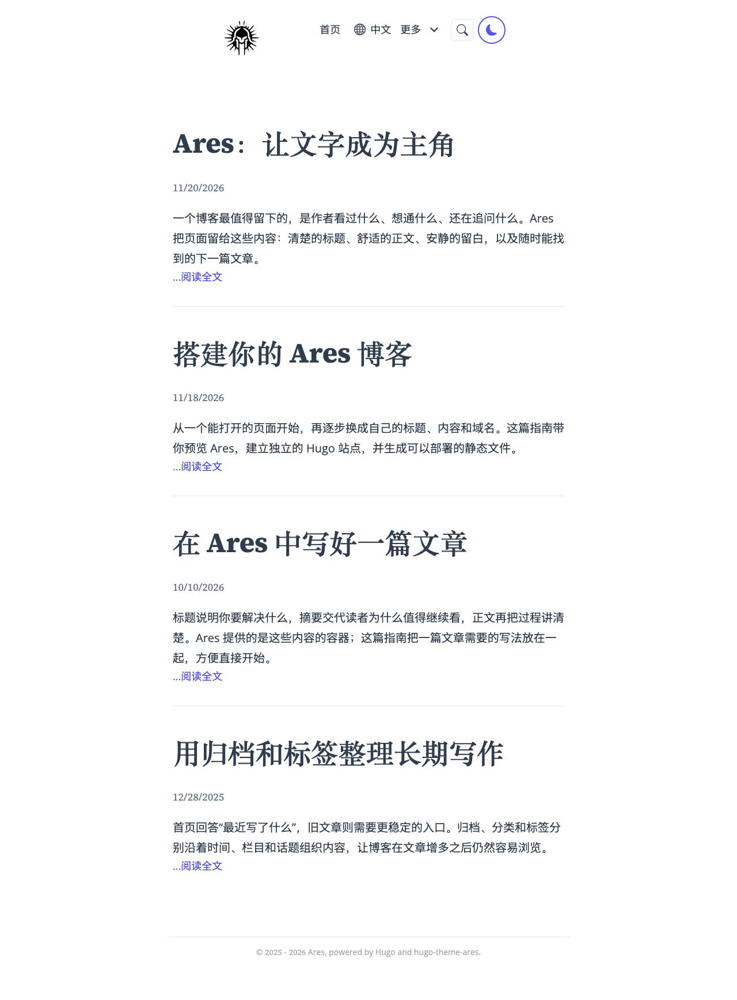

<!--
[INPUT]: Hugo 主题、完整示例站与使用配置文档。
[OUTPUT]: 项目定位、特性归纳、安装配置与文章示例。
[POS]: 项目文档入口；保留原作者与许可。
[PROTOCOL]: 变更时更新此头部，然后检查 AGENTS.md
-->

# Hugo Theme Ares

[English](docs/en/README.md)

Hugo Theme Ares 移植自 [Cytrogen/hexo-theme-ares](https://github.com/cytrogen/hexo-theme-ares)，专为注重文字表达的个人博客设计。主题保留 Ares 的单栏布局、SVG 图标、明暗配色与移动端交互，正文排版借鉴 [x7aNote](https://github.com/Xeonzilla/x7aNote) 的阅读节奏，采用衬线标题、宽松段落与衬线数字。日常撰写与发布仅依赖标准 Markdown 文件与 Hugo，页面构建完全静态化，无需 Node.js 运行环境。



[查看移动端预览](docs/images/mobile.png)

[查看正文排版](docs/images/article.png)

## 主题特性

- **阅读排版**：单栏居中布局，搭配衬线标题、18–20px 正文与统一段落间距。日期、年份和正文中的阿拉伯数字使用本地 Source Serif 4；代码使用等宽字体。支持首页摘要与分页、年份归档、分类与标签聚合、关于页及友情链接。
- **明暗主题**：原生支持浅色与深色模式，默认跟随系统偏好，支持手动切换并在本地保存选择。
- **移动适配**：原生响应式设计，搭配轻量抽屉导航菜单与原生折叠控件，无多余外部依赖。
- **多语言支持**：内置中文、英文、日文界面文案与独立内容隔离。跨语言文章支持译文精准跳转；缺少译文时平滑回退至目标语言首页。
- **本地搜索**：基于轻量静态 JSON 索引的客户端搜索，无需第三方搜索服务或动态后端，输入即时呈现结果。
- **代码与排版**：基于 Hugo Chroma 语法高亮，支持行号显示、指定行高亮、代码块标题、单键复制与长代码折叠。原生支持表格、引用、提示块与 HTML 折叠区块。
- **可选集成**：支持按需启用 Disqus 评论、Webmention 互动、MathJax 数学公式与 Google Analytics 统计（示例站默认全部保持关闭）。

## 本地预览示例站

运行示例站需要 **Hugo 0.158.0 或更高版本**（普通版本即可，无需 Extended 版）。

```sh
# 克隆主题仓库
git clone https://github.com/Harper-bai/hugo-theme-ares.git
cd hugo-theme-ares

# 启动示例站点预览
hugo server --source exampleSite
```

在浏览器打开终端提示的本地地址（通常为 `http://localhost:1313/`）。示例站预置了中文、英文与日文内容，首页每页最多展示 6 篇文章。编辑 `exampleSite/content/` 目录中的文章即可实时查看效果。

生成静态站点文件：

```sh
hugo --source exampleSite --minify
```

构建产物输出至 `exampleSite/public/`。

## 安装到自己的博客

### 1. 新建站点并引入主题

在你的工作目录中创建新的 Hugo 站点，并将主题作为 Git 子模块添加到 `themes/ares`：

```sh
hugo new site my-blog
cd my-blog
git init
git submodule add https://github.com/Harper-bai/hugo-theme-ares.git themes/ares
cp themes/ares/exampleSite/hugo.toml hugo.toml
```

### 2. 修改站点配置

打开复制生成的 `hugo.toml`，修改以下必要项：

```toml
baseURL = "https://example.com/"  # 替换为你的实际域名；若部署在子目录需写完整路径（如 https://example.com/blog/）
title = "你的博客名称"
theme = "ares"                    # 从示例的 hugo-theme-ares 改为 ares
themesDir = "themes"              # 从示例的 ../.. 改为 themes

[params]
  author = "你的名字"
  description = "博客描述信息"
```

> **注意**：请务必保留配置文件中的 `outputs`、`outputFormats` 与 `markup` 配置段。Hugo 不会自动继承主题模块的输出格式，这些设置是生成 `search.json` 搜索索引、`atom.xml` 订阅文件以及正确渲染 Markdown 代码高亮与 HTML 标签所必需的。

### 3. 导入初始内容与预览

如需使用现成的归档、关于页与友链模板，可将示例站的内容目录复制到博客中：

```sh
cp -R themes/ares/exampleSite/content/. content/
hugo server
```

已有 Hugo 站点时，只需将主题克隆至 `themes/ares/`，并将 `exampleSite/hugo.toml` 中的 `outputs`、`outputFormats`、`markup` 和 `params` 相关配置合并到你的站点配置文件中。

## 撰写文章

所有文章放置在 `content/posts/` 目录下。文件名使用语言代码作为后缀，例如新建中文文章 `content/posts/hello.zh.md`：

```markdown
---
title: 你好，世界
date: 2026-11-21T10:00:00+08:00
tags: [生活]
categories: [随笔]
draft: false
---

这里是显示在首页的文章摘要。

<!--more-->

这里是点击进入后展示的正文完整内容。
```

- **语言与翻译关联**：若同时编写英文版，保存为同名的 `hello.en.md`。主题会自动建立翻译关联并在导航栏提供切换入口；未翻译的文章切换时会自动回退到对应语言首页。
- **首页摘要**：正文中 `<!--more-->`（或 `<!-- more -->`）之前的内容会作为首页摘要并生成阅读全文链接；若省略分隔符，首页将直接展示全文。
- **草稿管理**：标记为 `draft: true` 的文章不会在正式构建中发布。本地写作时可通过 `hugo server -D` 预览草稿。

替换为自己的内容后，在博客根目录执行 `hugo --minify` 即可生成静态页面，产物输出至 `public/` 目录。

## 相关文档

- [使用说明](docs/guide.md)：文章编写规范、代码块语法高亮、归档与友链页面设置、公式排版。
- [配置说明](docs/configuration.md)：导航菜单、多语言细化配置、搜索范围以及 Disqus / Webmention / Google Analytics 等可选服务。
- [贡献说明](CONTRIBUTING.md)：本地开发、样式编译与提交前检查。

### 样式定制（可选）

主题已包含预编译的 `static/css/ares.css`，日常使用与静态发布无需额外安装 Node.js。仅当需要修改 `assets/scss/` 下的 Sass 源码时，才需要使用 npm：

```sh
npm install
npm run css
```

## 来源与许可

- **原版作者与项目**：页面布局与视觉设计来自 [Cytrogen/hexo-theme-ares](https://github.com/cytrogen/hexo-theme-ares)，其设计源自 [Hexo Theme Hermes](https://github.com/claymcleod/hexo-theme-hermes) 与 [Hexo Theme Apollo](https://github.com/sun4cs/hexo-theme-apollo)。
- **开源许可证**：本项目遵循 [MIT 许可证](LICENSE)。
- **字体说明**：内置的 Noto Sans SC、Open Sans、JetBrains Mono 与 Source Serif 4 离线字体均遵循各自的开源协议，授权文本保存在 `static/fonts/` 目录中。Source Serif 4 使用 SIL OFL 1.1 授权。
