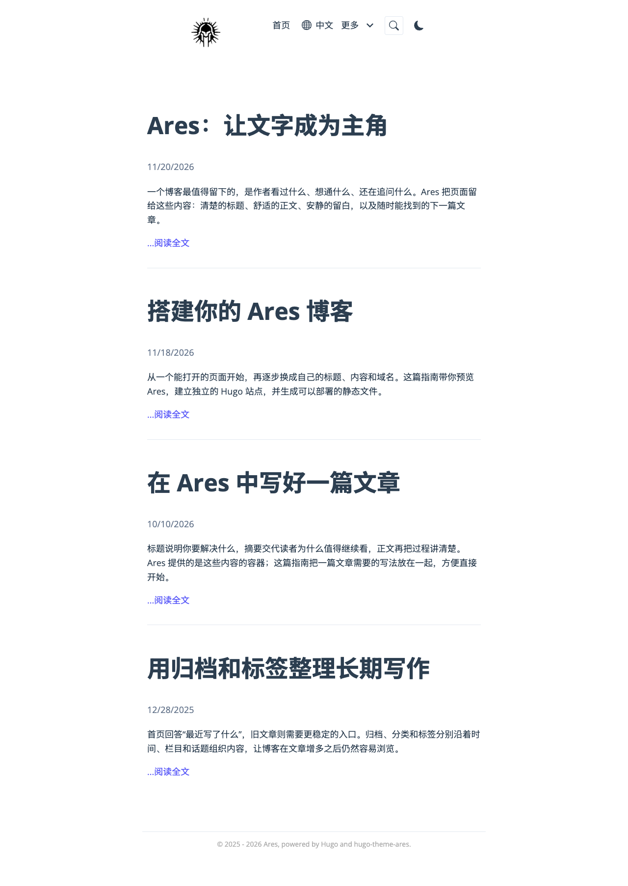

<!--
[INPUT]: Hugo 主题、介绍文章与完整示例配置。
[OUTPUT]: 英文预览、示例导览、新站安装和验证入口。
[POS]: 英文文档入口；与根 README 保持安装契约一致。
[PROTOCOL]: 变更时更新此头部，然后检查 AGENTS.md
-->

# Hugo Theme Ares

[中文](../../README.md)

A Hugo port of [Hexo Theme Ares](https://github.com/cytrogen/hexo-theme-ares), keeping its page layout, local fonts, SVG icons, light and dark palettes, and mobile reading experience. Write in Markdown and use Hugo to generate the static pages.



[View the mobile preview](../images/mobile.png)

## Preview locally

Requires **Hugo 0.158.0 or later**. A standard Hugo binary is enough. Node.js and Hexo are not required to build or serve the theme.

```sh
git clone https://github.com/Harper-bai/hugo-theme-ares.git
cd hugo-theme-ares
hugo server --source exampleSite
```

Open the address printed by Hugo, usually `http://localhost:1313/`. Save changes in `exampleSite/content/` to update the preview. The example enables Chinese, English, and Japanese. The homepage shows up to six posts per page.

Build the example with `hugo --source exampleSite --minify`. Its output goes to `exampleSite/public/`.

## Create your blog

Create a new Hugo site, install the theme, and copy the complete configuration:

```sh
hugo new site my-blog
cd my-blog
git init
git submodule add https://github.com/Harper-bai/hugo-theme-ares.git themes/ares
cp themes/ares/exampleSite/hugo.toml hugo.toml
```

Set these values in the copied `hugo.toml`:

```toml
baseURL = "https://example.com/"
title = "My blog"
theme = "ares"
themesDir = "themes"
```

Update the author, description, languages, and blogroll. Copy the example content if you want ready-made posts, archives, and about pages:

```sh
cp -R themes/ares/exampleSite/content/. content/
hugo server
```

For an existing site, install Ares in `themes/ares/` and merge the example settings into your configuration. Keep `outputs`, `outputFormats`, and `markup`: Hugo does not inherit all site settings from a theme.

## Write and publish

Store posts in `content/posts/`, using language suffixes such as `.en.md`. Matching filenames connect translations. The language menu opens a translation when one exists and the selected language's homepage otherwise.

Place `<!--more-->` between the homepage summary and the rest of the post. Without it, the homepage displays the full article. Use `draft: true` for unfinished work and `hugo server -D` to preview drafts. Normal builds do not publish them.

Replace the sample articles, about text, and blogroll with your own content. From your site's root, run `hugo --minify` and publish the generated `public/` directory. For a site under `/blog/`, set the complete path in `baseURL` before rebuilding.

## Features and documentation

Features include post summaries, pagination, archives, tags, categories, blogrolls, translated pages, local search, RSS, code copying and folding, and expandable HTML sections. Optional services include Disqus, MathJax, Google Analytics, and Webmention. The example leaves these external services disabled.

See the [content guide](guide.md), [configuration reference](configuration.md), and [contributing guide](../../CONTRIBUTING.md).

Optional Sass development uses `npm install` and `npm run css`. Site builds use the checked-in `static/css/ares.css`.

The MIT license and upstream author credits are retained. Original design: Cytrogen, based on Hexo Theme Hermes and Hexo Theme Apollo.
